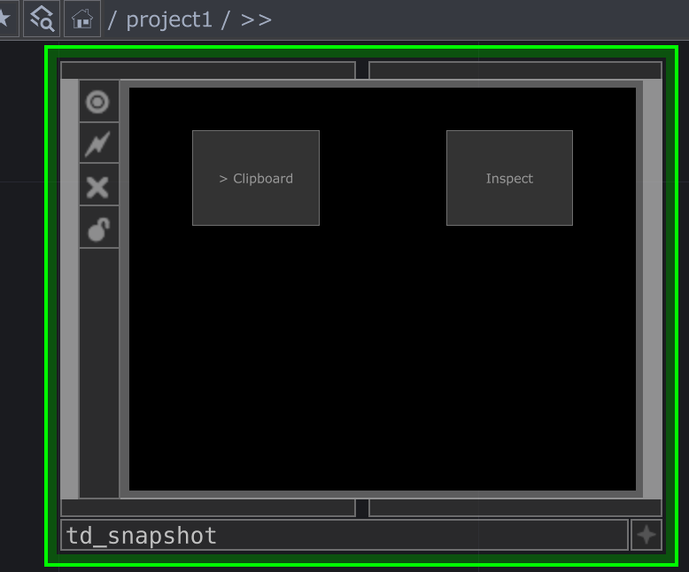
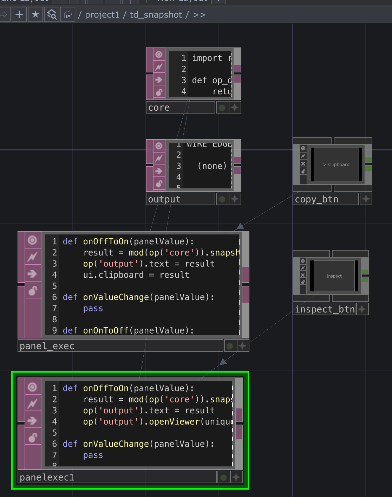

# td-snapshot

TouchDesigner networks are invisible to LLMs. This script captures your network as structured text — wiring, operator types, and every parameter that differs from its default — so you can paste it into a chat and get meaningful help debugging, refactoring, or explaining what a patch does.

It also works without LLMs: snapshot before and after a change and diff the output, or just audit what's actually non-default in a patch you inherited.

## Scope

`snapshot_patch()` captures the root operator and **all of its descendants** recursively. To target a specific sub-network, pass its path directly to `snapshot_patch()`.

The component running the snapshot excludes itself and its own children from the output automatically.

OP-typed value refs are recorded unconditionally — including targets in `/sys/`, `/local/`, and other system paths.

## Repo structure

```
src/
  core.py                ← edit this — snapshot_patch() lives here. Used by both options: concatenated onto quickpaste_runner.py to produce td-snapshot.py (Option 1), and loaded into the TOX's `core` Text DAT (Option 2)
  quickpaste_runner.py   ← entry point for Option 1 (Quick paste); concatenated onto core.py to produce td-snapshot.py
  tox_runner_copy.py     ← Option 2 — script that runs in the TOX's Copy button (Panel Execute DAT)
  tox_runner_inspect.py  ← Option 2 — script that runs in the TOX's Inspect button (Panel Execute DAT)
  hashes.txt             ← GENERATED by hashes.sh — source, toetools pin, .tox and toolchain checksums
  versions.txt           ← per-file version numbers — bump individually on changes
scripts/
  build.sh               ← rebuilds td-snapshot.py AND td-snapshot.tox from src/
  stamp.sh               ← called by build.sh — stamps version/hash headers onto src/*.py
  check.sh               ← called by build.sh — shellcheck on scripts + py_compile on src/*.py
  _toetools.sh           ← sourced by the scripts below — pins the toetools release (TOETOOLS_SPEC) used to edit tox/
  shrink.sh              ← called by build.sh — tocdir → .tox: patches DAT bodies in tox/ from src/*.py (via `toetools set-text`), runs toecollapse to rebuild td-snapshot.tox
  hashes.sh              ← called by build.sh after shrink — regenerates src/hashes.txt (source + toetools pin + .tox + toolchain checksums)
  grow.sh                ← .tox → tocdir: run after a TD GUI export to refresh tox/ for git diffing
  git-textconv-setup.sh  ← one-time per-clone setup: configures the `tocdir` git diff driver (see below)
  capture-dat-templates.sh ← run once per new TD build, with TD live: records its default DAT texts into dat-templates/ and regenerates core.py's template table
  dat_templates.py       ← used by capture-dat-templates.sh: assembles a dat-templates/ record; regenerates/checks the table in src/core.py
tests/                   ← snapshot renderer tests (test_core_*.py, test_dat_templates.py) and .toe samples
media/                   ← screenshots used by this README
td-snapshot.py           ← BUILT — do not edit directly
td-snapshot.tox          ← BUILT — the distributable component, drop into any project
tox/                     ← canonical text expansion of td-snapshot.tox, for git diffing
dat-templates/           ← running record of TD's default DAT texts, one <build>.json per TD build (see its README)
.gitattributes           ← routes tox/ .text/.table files to the toetools textconv diff driver
```

After editing `src/core.py`, run `./scripts/build.sh` to regenerate both `td-snapshot.py` and `td-snapshot.tox` (it calls `stamp.sh`, `shrink.sh`, and `hashes.sh` automatically). To bump a file's version, edit the corresponding entry in `src/versions.txt` before running the build.

The `tox/` directory is a text expansion of `td-snapshot.tox`. It serves two purposes: `build.sh` reads it as the source when rebuilding the binary (patching in updated DAT text), and `git diff tox/` makes binary `.tox` changes reviewable. After making structural changes in the TD GUI and exporting a fresh `td-snapshot.tox`, run `./scripts/grow.sh` to refresh it.

### Readable diffs for `.text` / `.table` files

Within `tox/`, individual `.text` (Text DAT body) and `.table` (Table DAT cells) files carry a binary length-prefixed preamble with embedded NUL bytes, so git treats them as opaque binary by default — `git diff` / `git log -p` on them normally just says `Binary files ... differ`, even though `.text` files hold the actual Python/GLSL source of every DAT in the snapshot tool (e.g. `tox/td_snapshot.tox.dir/td_snapshot/core.text`).

`.gitattributes` at the repo root routes `*.text`/`*.table` under `tox/` through a `diff=tocdir` driver backed by [toetools](https://github.com/rootnotez/toetools)' `toetools textconv <file>`, which renders `.text` files as their DAT body and `.table` files as one tab-separated line per row; anything it can't parse is passed through unchanged rather than hiding the diff. The same trees also get `-text` so no EOL normalization can ever corrupt the binary framing.

The textconv driver command itself lives in `.git/config`, which is never committed, so **every clone needs to run `./scripts/git-textconv-setup.sh` once** (it also works from any worktree of this repo, since worktrees share the parent's `.git/config`), and again after the toetools pin in `scripts/_toetools.sh` changes. After that, `git log -p -- tox/td_snapshot.tox.dir/td_snapshot/core.text` shows real source lines instead of a binary-diff notice.

## What it captures

Output is one block per operator. The first block is the root, under its absolute path; every other operator is named by its path relative to the root, in its header and wherever a wire or reference points at it. Adding or removing an operator therefore changes only its own block and the lines that point at it. A target outside the root keeps its absolute path; an `op('X')` in an expression that resolved to no operator is shown as `<unresolved X>`.

```
# td-snapshot v3.0.0 — each node block: "path [type]" (relative to the first block's path), changed pars, "in[N] <- src" for incoming wires, "ref par -> target" for parameter refs, "storage key = value" for op.store() data.

/project1 [Container COMP]

noise1 [Noise TOP]
  period = 0.5 (default 1.0)

blur1 [Blur TOP]
  flags: bypass=True
  storage tuned = {by: 'ari', pass: 2}
  blury = 5.0 (default 1.0)
  filter = 'gaussian' (default 'box')
  in[0] <- noise1

feedback1 [Feedback TOP]
  comment: holds the previous frame
  ref top -> fx/render1

fx/render1 [Render TOP]
  ref camera -> /scenes/cam1

text1 [Text DAT]
  dat_text:
    print('hello')
```

Within a block:

- The header `<path> [<Label Family>]` introduces the operator: the root's absolute path for the first block, a root-relative path for the rest.
- `<par> = <current> (default <default>[, <mode>][, expr=<text>])` lists each non-default or non-CONSTANT parameter. Mode and expression text are only shown when relevant.
- `comment:` carries the operator's comment — inline when single-line, or as an indented block when multi-line.
- `tags:` lists the operator's tags (`op.tags`), sorted and comma-separated; a tag containing whitespace, a comma or a quote is shown in quotes, e.g. `tags: effect, 'image filter'`.
- `flags:` lists operator flags, but only when one diverges from its type's default: `bypass=True`, `viewer=True`, `display=False`, `render=False`.
- `storage key = value` lists the operator's storage (`op.store()`), one key per line, sorted. Values are summarised on one line: a mapping shows its scalar fields and counts nested containers (`{3 items}`), an operator shows as `op('/path')`, `tdu.Dependency` wrappers are unwrapped, and long text is cut with its full length given. Memory addresses are dropped so the same storage prints the same way every run.
- `in[N] <- src` means input slot N is wired from `src`. Multi-output sources include `[out:K]`.
- `ref par -> target` means a parameter on this operator references `target` (via an `op()` call in an expression, or by an OP-typed parameter value such as a Feedback TOP's `top` parameter).
- `dat_text:` reproduces a DAT's text body as an indented block. When a length cap is set it ends with `(truncated, N chars total)`.
- A DAT still holding the exact default text TouchDesigner gave it (a docked callbacks DAT, an Execute DAT's body) shows as one line, `dat_text: (unchanged <type> template, N chars)`. The texts are recorded per TouchDesigner build in [`dat-templates/`](dat-templates/README.md).

Only parameters that differ from their defaults are shown — or any parameter driven by an expression, export, or bind, regardless of value. Stock settings are omitted to keep the output readable.

### Tuning what's captured

`snapshot_patch()` takes keyword toggles, all enabled by default, so you can drop categories you don't need: `include_comment`, `include_tags`, `include_storage`, `include_bypass`, `include_display`, `include_viewer`, `include_render`, `include_dat_text`, `dat_text_truncate` (set to an integer to cap each DAT body), and `collapse_dat_templates` (set to `False` to show unchanged template text in full). For example, `snapshot_patch(include_dat_text=False)` omits DAT text entirely, and `snapshot_patch(dat_text_truncate=2000)` caps long DAT bodies at 2000 characters.


## Usage Option 1: Quick paste

The fastest way to use it. No TOX required.

1. Copy `td-snapshot.py` into a **Text DAT** in your project.
2. Right-click the DAT > **Run Script**.

A new Text DAT named `td_snapshot_<timestamp>` is created in the same network and opens as a floating viewer. Select all and copy from there.

To target a specific network instead of the Text DAT's parent, edit the first line of `td-snapshot.py` before running:

```python
result = snapshot_patch('/project1/mycomp')
```


## Calling it from your own code (no side effects)

`snapshot_patch(root)` returns the snapshot as a string and creates or modifies nothing in the network, so you can snapshot before and after a change and diff the two without extra DATs appearing. Pass an explicit root path:

```python
text = mod('core').snapshot_patch('/project1/geo1')   # TOX: `core` Text DAT beside you
```

`mod('core')` works from a textport, extension or other script wherever a `core` DAT is reachable (the TOX ships one; or paste `src/core.py` into a Text DAT named `core`). The runners are the ones with GUI side effects: `td-snapshot.py` is `core.py` with `quickpaste_runner.py` appended, so it always creates a Text DAT and opens a viewer. Use it only for Option 1.

With a root given, `me` is not needed, so this works outside DAT scripts. When `me` is available, the component running the snapshot is still excluded. With no `me` and no root, it raises `ValueError` asking for a root.

## Usage Option 2: TOX component (reusable, button-triggered)

A Container COMP saved as a `.tox` that you can drop into any project. Two buttons — **Copy** and **Inspect** — each run the snapshot fresh and either put the result on your clipboard or open it in a floating viewer for reading. You can use the `.tox` directly from this repo.

### TOX Development
If you want to make changes, here is how the project is built.



Build the component with these operators inside a Container COMP:

| Type | Name | Source file |
|---|---|---|
| Text DAT | `core` | `src/core.py` |
| Text DAT | `output` | *(leave empty)* |
| Button COMP | `copy_btn` | *(no file — set Label to "Copy")* |
| Button COMP | `inspect_btn` | *(no file — set Label to "Inspect")* |
| Panel Execute DAT | `tox_runner_copy` | `src/tox_runner_copy.py` |
| Panel Execute DAT | `tox_runner_inspect` | `src/tox_runner_inspect.py` |

Set both Button COMPs to **Momentary** mode.

### Loading the scripts

For each DAT that has a source file, go to its **File** tab, set **File** to the absolute path of the corresponding `src/` file, and enable **Sync to File**. The DAT will pull in the file contents automatically. This keeps DATs in sync with the source without copy-pasting.



### Wiring the buttons

Each Panel Execute DAT needs its **Panels** parameter pointed at its corresponding button using the **relative name** (e.g. `copy_btn`, not a full path — absolute paths break when the component is dropped into a different network), **Panel Value** set to `select`, and **Off to On** set to **On**.

- **Copy** (`src/tox_runner_copy.py`) — runs the snapshot, writes to `output`, copies text to clipboard
- **Inspect** (`src/tox_runner_inspect.py`) — runs the snapshot, writes to `output`, opens a floating DAT viewer you can select and copy from

### Saving and reusing

Before saving for distribution, strip the file paths from every DAT that has one (`core`, `tox_runner_copy`, `tox_runner_inspect`):

1. Go to the **File** tab on each DAT
2. Clear the **File** field
3. Turn **Sync to File** off

The text content is already embedded — clearing the path just removes the external reference and any personal file system information. Nothing is lost.

Then right-click the Container COMP > **Save Component** and save as `td-snapshot.tox`.

If you want to keep the live file sync for your own development copy, re-set the File paths after saving — the `.tox` is a separate snapshot and won't be affected.

### Adding it to your palette

To make the component available in every project, add it to your palette. Open the **Palette** browser (the panel on the left, or **Alt+L**), then drag `td-snapshot.tox` from your file browser into the **My Components** section — or copy the `.tox` into your palette folder on disk. Once it's in the palette you can drag it into any network without locating the file each time.

You can also just drop the `.tox` into a project directly from the filesystem whenever you need it.

### Scripted build (maintainer note)

This repo can rebuild both `td-snapshot.py` and `td-snapshot.tox` from `src/` without opening TouchDesigner. After editing `src/core.py`, `src/tox_runner_copy.py`, or `src/tox_runner_inspect.py` (and bumping the file's version in `src/versions.txt`), run `./scripts/build.sh`. It lints, stamps version/hash headers onto `src/*.py`, rebuilds `td-snapshot.py`, then calls `shrink.sh`, which patches the `.text` DAT bodies in `tox/td_snapshot.tox.dir/` (via [toetools](https://github.com/rootnotez/toetools)' `set-text`, run through `uvx` at the release pinned in `scripts/_toetools.sh`) and runs `toecollapse` to rebuild the `.tox`, then `toetools verify` checks the patched tree still round-trips. Finally `hashes.sh` regenerates `src/hashes.txt` — recording the source-file checksums, the freshly built `.tox` checksum, and the `toeexpand`/`toecollapse` toolchain (with the TouchDesigner build) that produced it. This requires TouchDesigner installed at `/Applications/TouchDesigner.app` for the `toecollapse` CLI. For structural changes made in the GUI, **Save Component** over `td-snapshot.tox` and run `./scripts/grow.sh` to refresh `tox/` for git diffing.


## toeexpand parser (moved to toetools)

The pure-Python reader/writer for TouchDesigner's on-disk `.tox`/`.toe` expansion tree (the **tocdir** format), its format docs (`FORMAT.md`, `DEVIATIONS.md`, `ERRATA.md`, `TOOLCHAINS.md`), the toolchain regression tests and the wide-corpus stress runner now live in [rootnotez/toetools](https://github.com/rootnotez/toetools) (split out on 2026-10-18; their history before that is in this repo). This repo uses a pinned toetools release, set in `scripts/_toetools.sh`; set `TOETOOLS_SPEC` to build against another version or a local checkout.

### After updating TouchDesigner

1. **Check the toolchain.** In a toetools checkout, run `./scripts/toolchain-check.sh` and follow its "After updating TouchDesigner" runbook (record and compare goldens, re-check errata, write up deltas).
2. **Record its default DAT texts.** With the new TD running the td-claude-bridge component, run `scripts/capture-dat-templates.sh` here. It writes `dat-templates/<build>.json` and regenerates the template table in `src/core.py`. Add the build's row (and what changed since the previous build) to the table in [`dat-templates/README.md`](dat-templates/README.md), bump `core.py` in `src/versions.txt`, and run `./scripts/build.sh`. Until a build is recorded, untouched default DATs created in it are shown in full rather than collapsed. Commit `src/hashes.txt` (it records the toolchain that collapsed the `.tox`) along with the `dat-templates/` record.
